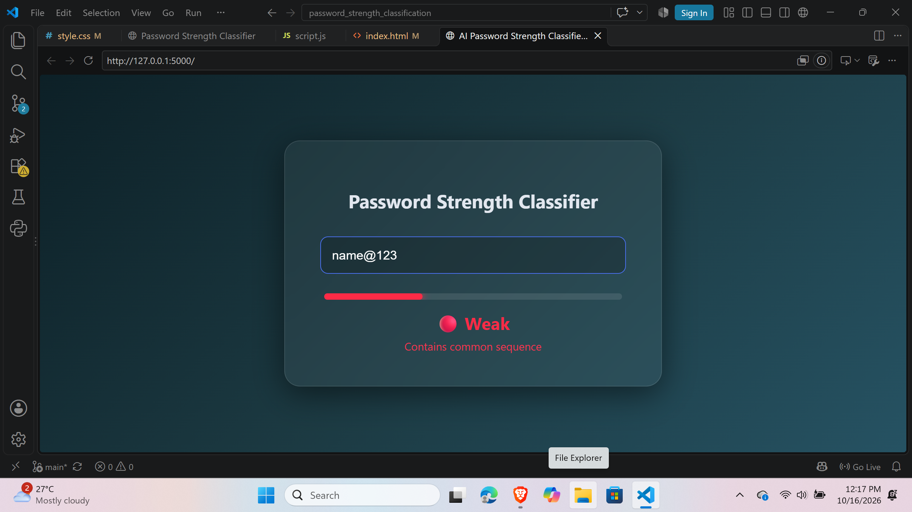
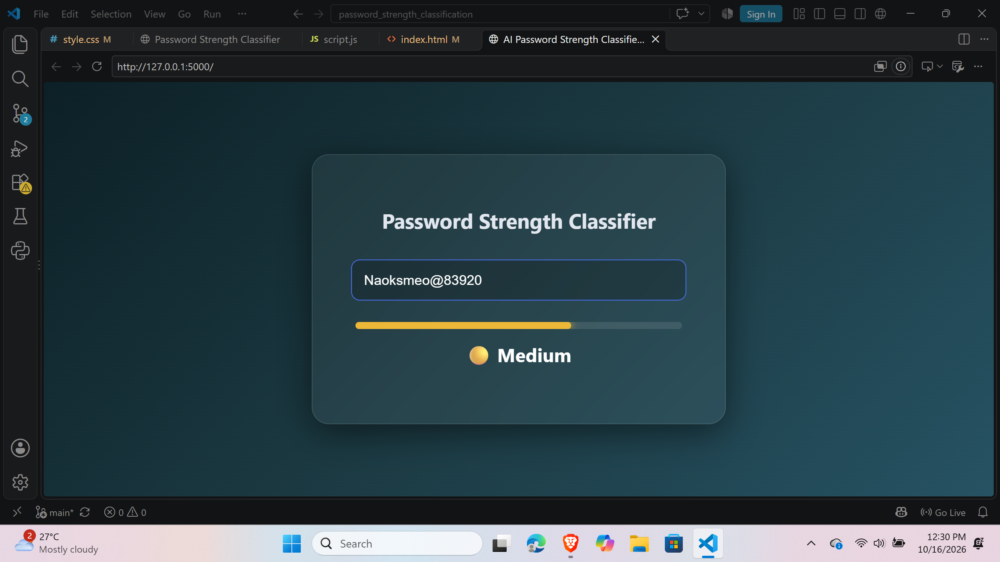
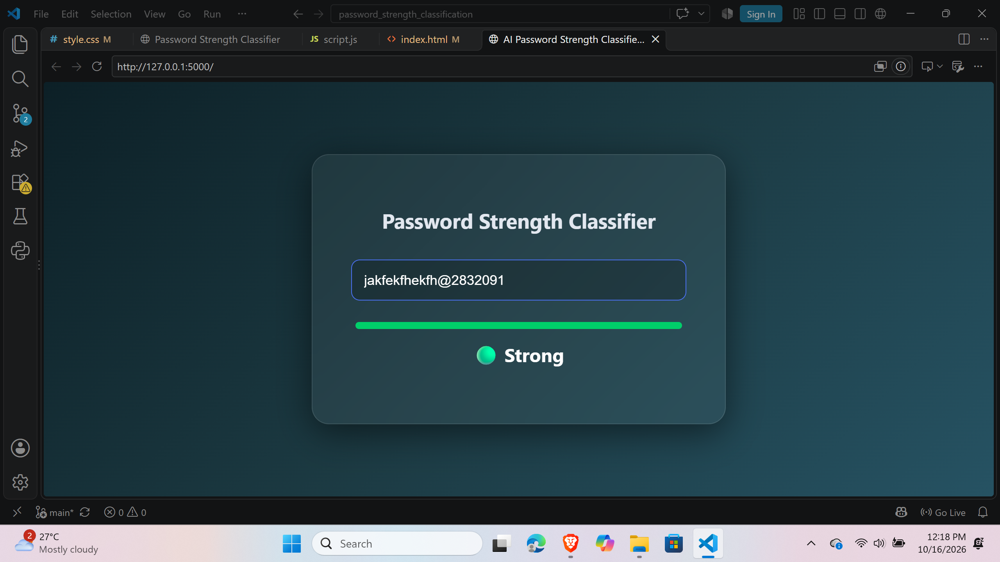

# AI Password Strength Classifier
Final-Year BCA Minor Project for real-time password security analysis.

**Machine Learning-Powered Password Strength Classification Using Feature Engineering**

## Project Description
The AI Password Strength Classifier is a machine learning-powered web application that analyzes password strength in real-time. The project applies custom mathematical feature-engineering pipelines, heuristic overrides, and a Logistic Regression model to identify weak, medium, and strong passwords through a modern Glassmorphism user interface.

## Objectives
* Grade passwords instantly as the user types.
* Calculate Shannon entropy, character distribution, and string length dynamically.
* Intercept common human-error patterns (e.g., dictionary words, sequential numbers) before they reach the AI.
* Provide visual feedback through a responsive, dark-mode glowing progress bar.
* Deploy a lightweight, fast-inference Flask API.

## Dataset
**Source:** Kaggle (240,000 Passwords for Machine Learning)

Classes used:
* Weak 
* Medium 
* Strong 

The dataset is uniformly distributed across the three classifications to ensure balanced model training and prevent bias.

## Methodology
```
Raw Password Input
↓
Heuristic Override Check (Common Sequences)
↓
Mathematical Feature Engineering
↓
Entropy & Character Distribution Calculation
↓
Logistic Regression Model Prediction
↓
Strength Classification (Weak/Medium/Strong)
↓
Dynamic UI Progress Bar Update
```
## Technologies
* Python
* Flask
* Scikit-Learn
* Pandas
* Joblib
* HTML5 & CSS3
* Vanilla JavaScript
* Vercel

## Project Output
The system produces:
* Real-time strength classification
* Color-coded progress bar fills (Red, Orange, Green)
* Custom warning messages for dataset blind spots
* A sleek Glassmorphism web interface

**Application Preview:**
* **Catching Common/Weak Passwords:** 
* **Evaluating Medium Passwords:** 
* **Validating Strong Passwords:** 

## Limitations
The system evaluates mathematical complexity and common structural patterns. It does not currently cross-reference inputs with live breached password databases (e.g., Have I Been Pwned API) for active threat detection.

## Future Scope
* Integration with breached password APIs
* Expanded dataset with multilingual dictionary words
* User authentication system integration
* Mobile application deployment

## Project Structure
```text
password_strength_classification/
├── data/
│   └── processed/engineered_passwords.csv
├── images/
│   ├── demo-medium.jpg
│   ├── demo-strong.jpg
│   └── demo-weak.jpg
├── models/
│   ├── lr_model.joblib
│   └── scaler.joblib
├── notebooks/
│   ├── 01_data_exploration.ipynb
│   └── 02_model_training.ipynb
├── static/
│   ├── script.js
│   └── style.css
├── templates/
│   └── index.html
├── app.py
├── requirements.txt
└── vercel.json
```

## 👩‍💻 Author
Helena Saji
